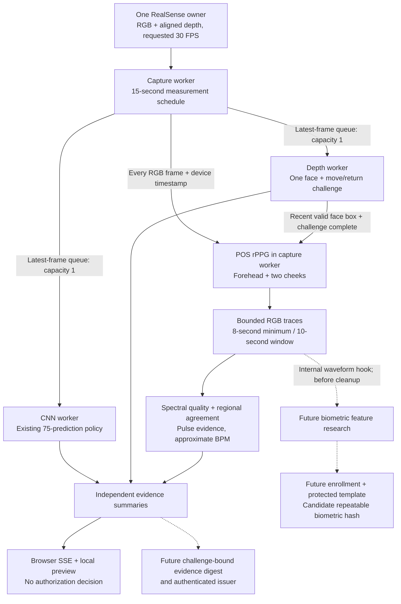

# rPPG minimum viable implementation

Implemented 2026-11-20 on `codex/rppg-mvp`, based on `liveness_detection`
commit `b4b48cea8453b91929e11ec47a192684d448dc85`.

## Scope and use

The existing RealSense D435 supplies RGB and aligned depth at a requested 30 FPS.
An original NumPy implementation of **POS (plane orthogonal to skin)** extracts
relative blood-volume-pulse (BVP) traces from three rectangular facial regions.
It requires no downloaded weights, external API, PyTorch, or NVIDIA GPU. This
baseline was selected before adding FacePhys or another learned extractor so
capture timing, invalidation, and output contracts can be tested independently.

The intended deployment is a Pi 5 with 8 GB or 16 GB of RAM and a 64-bit Linux OS,
or an Ubuntu workstation. CPU execution is the baseline on all platforms; this
MVP does not add CUDA acceleration. The Pi's performance and memory use have
**not** been measured. Existing RealSense, OpenCV, Flask, NumPy and LiteRT
dependencies still apply; no new inference dependencies were added.

1. Start the existing application and sign in using a locally provisioned account.
2. Read the collection notice, then select **Start camera check**.
3. Complete the move-closer/return depth prompt promptly.
4. Hold still in steady, even lighting for at least eight seconds afterward.
5. Read the separate media, depth, and pulse results in the browser/preview.
   Start another check if evidence is incomplete or inconclusive.

The native preview is optional: set `ZTA_CAMERA_PREVIEW=0` before launch for a
headless Pi. Browser controls/status still work. Flask must remain loopback-only;
the camera belongs to the machine running Python, not to a remote browser.

Programmatic `create_app(config)` settings (no browser-controlled thresholds):

| Setting | Default | Purpose |
| --- | --- | --- |
| `CAPTURE_SECONDS` | `15.0` | Measurement schedule after SDK startup |
| `RPPG_MIN_SECONDS` | `8.0` | Minimum contiguous usable pulse segment |
| `RPPG_WINDOW_SECONDS` | `10.0` | Maximum pulse trace history |
| `SAMPLE_INTERVAL` | `0.2` | Depth/CNN sampling interval; does not gate rPPG |
| `CAMERA_PREVIEW` | `True` | Native preview; environment `ZTA_CAMERA_PREVIEW=0` disables it |

Other research thresholds are constructor settings on `PosRppgAnalyzer`, supplied
through the pipeline's injectable `rppg_factory` when experimenting locally.

Capture is scheduled to end after **15 seconds from SDK startup completion**.
Camera startup, a pending SDK read (normally bounded by its 1000 ms timeout),
processing, and up to two seconds of consumer cleanup can add wall-clock time.
This is a bounded capture schedule, not a demonstrated hard real-time guarantee.
An eight-second usable pulse segment fits only if the depth challenge and face
stabilization finish sufficiently early. Capture is not automatically extended.

The inherited CNN policy still requires 75 predictions at its inherited 70%
threshold. A slow CNN may therefore remain `collecting` at the deadline. Neither
that threshold nor the rPPG thresholds were recalibrated to manufacture a pass.
`completed` means capture ended; it does not mean all checks passed.

### Linux installation considerations

Use the existing `requirements-inference.txt` and platform setup in the README.
The rPPG module itself uses Python 3.10+ syntax and NumPy. The tests were run on
macOS/Python 3.12; Linux camera/runtime compatibility remains to be tested.

For the Pi, verify the RealSense SDK build before launching the application.
As checked on 2026-11-19, the official ARM64 Python wheels target NVIDIA JetPack
and include CUDA dependencies; the publisher directs CPU-only users to build
from source. An ARM64 wheel tag alone does not establish Pi compatibility:
[RealSense Python package](https://pypi.org/project/pyrealsense2/) and
[official source-build instructions](https://github.com/realsenseai/librealsense/tree/master/wrappers/python#building-from-source).
Do not run the Flask process as root to work around camera permissions.

## Data flow

Solid paths are implemented. Dashed paths identify future consumers only.



## Implementation and algorithm

### Capture coordination: `zta/frame-handler.py`

One capture thread creates, reads, and stops the SDK source. It feeds two
single-slot latest-frame queues: one for CNN inference and one for depth
analysis. A consumer can keep its currently processing frame and one pending
frame; backlog cannot grow with capture duration. Older pending frames are
replaced, not accumulated. Slow CNN execution does not impose its sampling rate
on rPPG. Native preview is capped at 10 updates/second by default.

Depth/CNN consumers sample using frame capture time and the existing 0.2-second
interval. This replaces the previous extra 0.2-second wait after inference.
Actual throughput can still be lower than requested because of SDK alignment,
CPU scheduling, face detection, preview, or pulse processing. Timing checks
detect some of these failures; the application does not assume 30 FPS was met.

Stop, navigation cleanup, logout, deadline, or failure stops acquisition,
requests consumer termination, releases the camera, and clears pulse buffers.
An in-flight consumer cannot publish evidence after stop. If it fails or cannot
exit within the cleanup budget, phase becomes `failed`; a still-running
consumer keeps the capture slot busy until it exits. Python cannot forcibly
cancel an arbitrary native inference call.

CNN inference no longer holds the verification-service session lock. Ownership
and expiry are checked both before and after inference, so cancellation can
remove a session and its late prediction cannot recreate evidence.

### Pulse extraction: `zta/liveness/rppg.py`

1. Accept a recent depth candidate with exactly one face and a completed depth
   challenge. Before completion, pulse status asks the user to finish movement.
2. Extract mean RGB from forehead and two cheek rectangles relative to that face
   box. Reject a region if too many pixels are dark/clipped. These rectangles
   are not landmark-based skin segmentation and can include non-skin content.
3. Store only nine color values and a timestamp per sample, in a bounded deque
   (302 records with default settings). No full-frame video buffer is retained.
4. Reset on face loss, invalid depth, stale ROI (over 0.75 s), substantial box
   movement relative to the initial box, duplicate/backward frame numbers or
   timestamps, exposure failure, or a sample-time gap over 0.15 s. Minor jitter
   within a continuous segment is interpolated to a uniform time grid.
5. After at least eight seconds, run POS on overlapping 1.6-second windows.
   Normalize each channel by its local temporal mean, project
   `S1 = G - B`, `S2 = G + B - 2R`, combine
   `H = S1 + std(S1)/std(S2) * S2`, remove its local mean, and overlap-average.
6. Remove a linear trend. Compute a Hann-windowed spectrum and search 0.7–3 Hz
   (42–180 BPM). This is a limited prototype range, not a clinical validity range.
7. Measure concentration near the strongest in-band spectral peak relative to
   all non-DC spectral power. Require at least two regions with concentration
   at least 0.45 and rate agreement within 8 BPM. This concentration is not an
   SNR, liveness confidence, or calibrated probability. Recalculate at most once
   per second over the latest ten seconds.

RealSense's color-frame timestamp (milliseconds converted to seconds) determines
pulse sample spacing. The existing host-monotonic capture time separately
determines ROI age and capture scheduling. A device timestamp is not a trusted
wall-clock time or proof against replay. Injected non-SDK sources may omit the
optional `sensor_timestamp` and use `captured_at` for sampling instead.

### Evidence and future processing

Browser SSE adds an `rppg` summary alongside existing media and `liveness` fields:

| Field | Meaning |
| --- | --- |
| `status` | `collecting`, `signal_detected`, `inconclusive`, or `unavailable` |
| `reason`, `instruction` | Machine-readable cause and capture guidance |
| `sample_count`, `duration_seconds`, `effective_fps` | Coverage of the evaluated segment |
| `bpm` | Approximate rate, present only when regional criteria are met |
| `quality` | Spectral concentration, not a probability |
| `algorithm_id` | `pos-v1`; processing defaults are documented here |

`signal_detected` indicates consistent periodic color evidence only. Absence of
a usable signal is inconclusive/unavailable, not automatically a spoof verdict.
Camera/model failure or cancellation invalidates pulse evidence. All waveform
buffers are released on termination; only the small summary remains in the
existing in-memory camera-run record until it is replaced by another run.

`PosRppgAnalyzer.waveform()` is an internal Python hook returning an immutable
copy of timestamps and three relative, band-limited BVP traces for the latest
accepted analysis. It is available only during the active capture and is cleared
on invalidation/cleanup. No waveform HTTP endpoint, persistence, hash generation,
enrollment, or identity matching was added. A future local consumer must be
explicitly integrated before cleanup; morphology research may also need to retain
pre-filter POS outputs under a separately designed consent/retention policy.

The two future uses remain distinct: a per-attempt evidence digest needs request,
subject, device, fresh challenge, times, and version binding plus issuer integrity;
a repeatable biometric key needs enrollment, stable discriminative features,
and an error-tolerant protected-template design. Hashing waveform bytes alone
does not establish either property.

## Verification

Run from the repository with its inference environment active:

```sh
python -m unittest discover -s tests -v
python -m compileall -q zta
node --check zta/web/static/app.js
```

Node is optional for checking JavaScript syntax and is not an application runtime
dependency. The automated suite uses no physical camera, GPU, network, or
downloaded physiological model. It checks known synthetic pulse recovery,
noise/static/common-brightness rejection, timing and face invalidation, bounded
storage, independent slow-CNN capture, cancellation, failure/expiry handling,
owner isolation, and terminal SSE behavior. Synthetic tests establish code
behavior only; they do not measure liveness accuracy or skin-tone performance.

Observed on 2026-11-20: **21 automated tests passed** on macOS/Python 3.12, along
with Python compilation, JavaScript syntax and whitespace checks. The retained
LiteRT model executed on a synthetic RGB array, and preview composition with a
pulse summary returned a side-by-side image. Neither check opened a real camera
or validated physiological accuracy.

Before accepting the Pi deployment, run the actual D435 and retained CNN on Pi 5
8 GB and 16 GB / 64-bit Linux, with USB 3, adequate power and active cooling.
Measure actual frame timing, p95 total time, depth-challenge completion, peak
resident memory, CPU/temperature, swap activity, and retry rate. Compare pulse
results with synchronized contact PPG and evaluate held-out people/sessions and
print, replay, mask, illumination, and injected-media attacks. Keep the CNN
window/threshold calibration and combined access policy as separate work.

## Sources and limits

- [Wang et al., Algorithmic Principles of Remote PPG](https://doi.org/10.1109/TBME.2016.2609282):
  POS algorithm reference. The NumPy implementation here was written for this
  project; no library source or pretrained assets were copied.
- [OR-PAD](https://github.com/marukosan93/OR-PAD): fabricated pulse signals can
  appear in presentation attacks. Periodicity and agreement alone do not prove
  a live person or authenticate an identity.
- [LiteRT platform packages](https://pypi.org/project/ai-edge-litert/): retained CNN
  runtime availability is distinct from tested Pi performance.

There is no new fused `live` Boolean, trusted-capture claim, stable biometric
hash, or automatic access grant in this MVP. Existing depth `live` still denotes
the prototype depth challenge outcome only.
